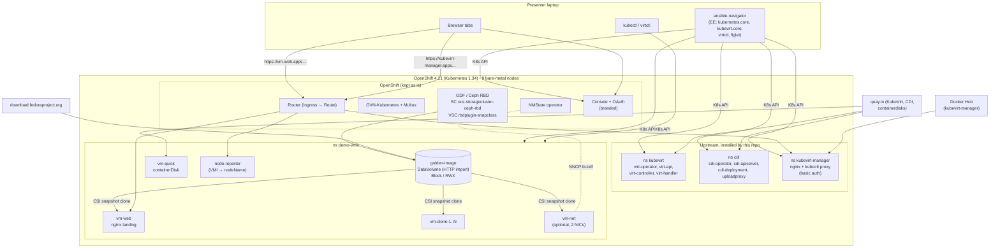

# Texas Linux Fest 2026 — Upstream KubeVirt demo

**Upstream KubeVirt: VMs the Kubernetes way.** This repo uses Ansible to deploy
upstream [KubeVirt](https://kubevirt.io) and
[CDI](https://github.com/kubevirt/containerized-data-importer) on an OpenShift
bare-metal lab. It uses standard Kubernetes APIs (Ingress, DataVolumes on CSI,
VolumeSnapshots, Multus) and is branded for
[Texas Linux Fest 2026](https://2026.texaslinuxfest.org/) (Nov 6–7, 2026, Austin TX).

What you get:

- **KubeVirt** and **CDI** from the GitHub release manifests, with pinned versions.
- **[kubevirt-manager](https://github.com/kubevirt-manager/kubevirt-manager)** as the UI, exposed with an Ingress and event branding.
- **OpenShift console branding**: product name, light and dark logos, favicon, a banner, links, and the OAuth login page.
- **Demo VMs** in `demo-vms`:
  - `vm-quick`: a containerDisk VM.
  - `golden-image`: Fedora imported onto RBD Block/RWX.
  - `vm-web`: a snapshot clone of `golden-image` running nginx and the event landing page.
  - N clones made with `kubevirt.core`.
  - `vm-net`: optional, with a second NIC on a Linux bridge.
- **Demo steps**: live migration, plus VirtualMachineSnapshot and restore.
- **Safe removal of OpenShift Virtualization** when it is installed, and a full **teardown**.

---

## Architecture



### Upstream vs OpenShift-specific

| Piece | API used | Notes |
|---|---|---|
| KubeVirt, CDI | Release manifests + `kubevirt.io/v1`, `cdi.kubevirt.io/v1beta1` | virt-operator and cdi-operator detect OpenShift and create their own SCCs |
| Disks | `DataVolume` → PVC on CSI (ODF RBD), `VolumeSnapshotClass` | `storageClassName`, `volumeMode: Block` and `accessModes: [ReadWriteMany]` are always explicit |
| Exposure | `networking.k8s.io/v1` **Ingress** | OpenShift turns each Ingress into a Route (see below) |
| Secondary network | NMState NNCP + Multus `NetworkAttachmentDefinition` (standard `bridge` CNI) | NMState is an operator, not upstream Kubernetes |
| Ansible | `kubernetes.core`, `kubevirt.core` | No `redhat.openshift` collection and no `oc` |

**Places where it can't be 100% vanilla on OpenShift, and what this repo does instead:**

1. **Ingress → Route.** We create plain Ingress objects (`ingressClassName: openshift-default`). OpenShift's ingress-to-route controller creates a Route for each one, and the annotation `route.openshift.io/termination: edge` gives TLS with the router's default certificate.
2. **Console and OAuth branding** only exist in OpenShift CRs: `Console` (operator.openshift.io), `OAuth` (config.openshift.io), `ConsoleNotification` and `ConsoleLink`. They are handled with `kubernetes.core.k8s`, because they're just CRs. The OAuth templates are written by this repo with the same Go template fields that `oc adm create-login-template` generates, so **`oc` is never needed**.
3. **Removing OpenShift Virtualization** goes through OLM objects (Subscription, CSV). These are also plain CRs, managed with `kubernetes.core.k8s`.
4. **Pod Security Admission.** The `kubevirt`, `cdi` and `demo-vms` namespaces are labelled `privileged`, with `security.openshift.io/scc.podSecurityLabelSync: "false"` so OpenShift doesn't overwrite the label.
5. **kubevirt-manager** runs a fixed UID (10000) upstream. We drop it so restricted-v2 can assign one.

### Versions (verified 2026-10-23)

| `ocp_version` | Kubernetes | KubeVirt | CDI | Console logos |
|---|---|---|---|---|
| **4.21** (default) | 1.34 | **v1.9.1** | **v1.66.1** | `spec.customization.logos` (light, dark, favicon) |
| 4.18 | 1.31 | v1.6.6 | v1.63.1 | `customLogoFile` fallback (one logo, no dark variant or favicon) |

- **KubeVirt and Kubernetes:** see the [KubeVirt support matrix](https://github.com/kubevirt/sig-release/blob/main/releases/k8s-support-matrix.md). KubeVirt 1.9 supports Kubernetes 1.34–1.36. Kubernetes 1.31 (OCP 4.18) works with KubeVirt 1.6 but is now **EOL upstream**.
- **CDI and Kubernetes:** CDI has no formal matrix. The versions above match its CI lanes.
- **Feature gates:** `Snapshot` is Beta, so it's on by default; we still list it. `LiveMigration` is GA. Nothing else is needed.
- **kubevirt-manager:** 1.5.4 (`docker.io/kubevirtmanager/kubevirt-manager:1.5.4`, amd64 only).
- **Collections:** `kubernetes.core` 6.6.0 and `kubevirt.core` 2.3.0.
- **Guest image:** Fedora 44 (`Fedora-Cloud-Base-Generic-44-1.7`, `quay.io/containerdisks/fedora:44-1.7`).

To support another OpenShift version, add a row to `compat_matrix` in [group_vars/all/versions.yml](group_vars/all/versions.yml) after you check the support matrix.

---

## Prerequisites

### Cluster

- **OpenShift:** 4.21 (or 4.18; set `ocp_version`), with cluster-admin access.
- **ODF:** a Ceph RBD StorageClass with Block/RWX support, a matching VolumeSnapshotClass, Ceph `HEALTH_OK`, and ≥ 50 GiB free.
- **Nodes:** at least **2 workers with `/dev/kvm`** for live migration. With fewer, migration is disabled automatically.
- **NMState:** the operator plus an `NMState` instance. This is only needed for the optional secondary network.
- **Wildcard DNS:** `*.apps.<cluster>` must resolve from the laptop.
- **Outbound access** from the nodes:
  - `quay.io`
  - `github.com` (release manifests are downloaded by the laptop)
  - `download.fedoraproject.org` (CDI importer)
  - Docker Hub (kubevirt-manager), or a mirror set in `kubevirt_manager_image_registry`
- **OpenShift Virtualization:** it may be installed; `site.yml` removes it. **MTV must not be installed.**

### Laptop

```bash
# Python tooling (or use the execution environment, recommended)
pip install ansible-navigator ansible-builder
```

You also need:
- **podman** (or docker) for the execution environment.
- **kubectl** 1.34.x, matching the cluster.
- **virtctl, the same version as KubeVirt**:

```bash
VERSION=v1.9.1   # v1.6.6 for OCP 4.18
ARCH=$(uname -m | sed 's/x86_64/amd64/;s/aarch64/arm64/')
OS=$(uname -s | tr '[:upper:]' '[:lower:]')
curl -fL -o virtctl "https://github.com/kubevirt/kubevirt/releases/download/${VERSION}/virtctl-${VERSION}-${OS}-${ARCH}"
chmod +x virtctl && sudo mv virtctl /usr/local/bin/
virtctl version --client
```

- **An SSH key pair.** The public key goes into the VMs. The default is `~/.ssh/id_ed25519.pub`; change it with `vm_ssh_pubkey_file`.
- **A kubeconfig** with cluster-admin, in `KUBECONFIG` or `~/.kube/config`.

### Build the execution environment

From this `ansible/` folder:

```bash
ansible-builder build -t txlf-2026-ee:latest
```

For OCP 4.18 (KubeVirt v1.6.6):

```bash
ansible-builder build -t txlf-2026-ee:4.18 --build-arg VIRTCTL_VERSION=v1.6.6 --build-arg OC_CHANNEL=stable-4.18
```

The EE contains ansible-core, the two collections, the kubernetes Python client, passlib, `virtctl`, `kubectl`/`oc`, `figlet` and ImageMagick. [ansible-navigator.yml](ansible-navigator.yml) mounts `~/.kube` and `~/.ssh` into it.

To run without the EE:

```bash
pip install -r requirements.txt
ansible-galaxy collection install -r requirements.yml -p collections
```

Then use `ansible-playbook` instead of `ansible-navigator run`. Without `figlet` on the laptop, the MOTD uses the pre-rendered banner in `files/branding/motd-banner.txt`.

---

## Repository layout

Everything lives in this `ansible/` folder, which sits inside the larger
workshop repository. Run every command (`ansible-navigator`, `ansible-builder`,
`kubectl apply -f manifests/...`) from here.

```
ansible/
├── README.md  NOTICE  .gitignore  .yamllint  .ansible-lint
├── preflight.yml  site.yml  demo.yml  reset.yml  teardown.yml  verify.yml
├── ansible.cfg  ansible-navigator.yml  inventory/
├── execution-environment.yml  requirements.yml  requirements.txt  bindep.txt
├── group_vars/all/
│   ├── event.yml       # event name, slug, texts, colors, links, MOTD
│   ├── versions.yml    # compat_matrix (OCP → KubeVirt/CDI), images, URLs
│   └── infra.yml       # ocp_version, storage, placement, cpuModel, NIC, mirrors, demo sizes
├── roles/
│   ├── preflight/          # read-only checks → reports/preflight.md
│   ├── cnv_removal/        # removes OpenShift Virtualization (confirm_cnv_removal)
│   ├── kubevirt/           # operator + KubeVirt CR (also: shared apply_manifest.yml)
│   ├── cdi/                # operator + CDI CR, importProxy, StorageProfile
│   ├── kubevirt_manager/   # UI, nginx with auth on /k8s, branding, Ingress
│   ├── console_branding/   # Console CR, banner, links, OAuth templates (+ backup)
│   ├── demo_network/       # NNCP Linux bridge + NAD (optional)
│   ├── demo_vms/           # golden-image, VMs, clones, migrate, snapshot, reset, verify
│   └── teardown/           # reverse of everything (confirm_teardown)
├── manifests/          # hand-written YAML for `kubectl apply` on stage
├── files/branding/     # TXLF logos (pinned commit, see NOTICE)
├── scripts/fetch-branding.sh
└── reports/            # preflight.md, console/oauth originals, kubevirt-manager password
```

---

## Execution order

Run these from this `ansible/` folder. Reports and generated files land in `reports/`.

**1. Preflight (read-only).** It writes [reports/preflight.md](reports/preflight.md):

```bash
ansible-navigator run preflight.yml
```

It reports:
- Nodes with roles, labels, taints, ODF membership, `/dev/kvm` and CPU model.
- Free CPU and RAM.
- Storage, Ceph health and capacity.
- Whether CNV or MTV is installed.
- NMState and free NICs.
- Proxy, DNS and the Ingress certificate.
- Access to quay.io, Docker Hub (with the rate limit), github.com and Fedora.

At the end it proposes a YAML block for `infra.yml`.

If node labels can't show `/dev/kvm` (CNV not installed and no NFD), you can allow one short-lived privileged pod per worker. It runs in a temp namespace that is deleted afterwards:

```bash
ansible-navigator run preflight.yml -e preflight_node_probe=true
```

**2. Review the report together.** Copy the proposed values into `group_vars/all/infra.yml`.

**3. Full install.** This also removes OpenShift Virtualization if it is present:

```bash
ansible-navigator run site.yml -e confirm_cnv_removal=true
```

To preview the CNV removal first:

```bash
ansible-navigator run site.yml --tags cnv_removal -e confirm_cnv_removal=true --check
```

**4. Run again to confirm idempotency.** Expect `changed=0`:

```bash
ansible-navigator run site.yml -e confirm_cnv_removal=true
```

**5. Before the talk:**

```bash
ansible-navigator run reset.yml
```

```bash
ansible-navigator run demo.yml
```

**6. Afterwards:**

```bash
ansible-navigator run teardown.yml -e confirm_teardown=true
```

### Tags

| Playbook | Tags |
|---|---|
| site.yml | `preflight`, `cnv_removal`, `kubevirt`, `cdi`, `kubevirt_manager`, `console_branding`, `demo_network`/`network`, `demo_vms`, `verify` |
| demo.yml / site.yml | `quick`, `web`, `clone` (golden-image), `scale`, `network`, plus `migrate`, `snapshot`, `restore` (these three only run when asked for) |
| teardown.yml | `demo`, `network`, `kubevirt_manager`, `cdi`, `kubevirt`, `branding` |

### kubevirt-manager credentials

Upstream kubevirt-manager only puts basic auth on the UI (`location /`). The `/k8s` path, a `kubectl proxy` with cluster-wide VM rights, stays open. This repo ships its own nginx `default.conf`, based on v1.5.4, with **auth on `/k8s` too**. Auth is always on:

- **User:** `admin`
- **Password:** `kubevirt_manager_auth_password`, or, if that's empty, a password generated once into `reports/kubevirt-manager-password`.

---

## Live demo script (~25 min)

Set up the terminal first, in this `ansible/` folder:

```bash
export KUBECONFIG=~/.kube/txlf-lab
kubectl config set-context --current --namespace=demo-vms
alias k=kubectl
```

### 1. Welcome (1 min)

Show the OpenShift console in the browser:
- The TXLF banner, the logo in light and dark mode, and the product name.
- **Application menu → Texas Linux Fest 2026** links.

### 2. KubeVirt is just Kubernetes (2 min)

```bash
k get kubevirt -n kubevirt -o custom-columns=NAME:.metadata.name,VERSION:.status.observedKubeVirtVersion,PHASE:.status.phase
k api-resources --api-group=kubevirt.io
k get pods -n kubevirt
```

### 3. A VM from a container image, live (4 min)

```bash
./manifests/00-ssh-key.sh
k apply -f manifests/01-vm-live.yaml
k get vm,vmi vm-live -w                     # Ctrl-C when Running
k get pod -l vm.kubevirt.io/name=vm-live -o wide
virtctl ssh fedora@vm/vm-live               # show the motd, `uname -a`, exit
virtctl console vm-quick                    # vm-quick: TXLF /etc/issue banner (Ctrl-] to exit)
```

### 4. Storage: golden image and snapshot clones (3 min)

```bash
k get dv,pvc golden-image                   # Block, RWX, ocs-storagecluster-ceph-rbd
k get storageprofile ocs-storagecluster-ceph-rbd -o jsonpath='{.status}' | jq
k apply -f manifests/02-vm-clone-live.yaml
k get dv vm-clone-live-rootdisk -w          # CSI snapshot clone: done in seconds
k get volumesnapshot
```

### 5. Scale with Ansible + UI (3 min)

```bash
ansible-navigator run demo.yml --tags scale -e clone_count=5
k get vm -l app.kubernetes.io/component=clone
```

Show **kubevirt-manager** in the browser (TXLF branding), and the VMs on their nodes.

### 6. Live migration — the audience watches the landing page (4 min)

Open `https://vm-web.apps.<domain>`. It shows the node and refreshes every 2 seconds.

```bash
k get vmi vm-web -o wide                    # current NODENAME
virtctl migrate vm-web                      # or: k create -f manifests/03-migration.yaml
k get vmim -w                               # Scheduling → Running → Succeeded
k get vmi vm-web -o wide                    # new NODENAME
```

The landing page shows "Live migration in progress", then the new node flashes in orange, without a page reload.

### 7. Snapshot and restore (5 min)

```bash
k apply -f manifests/04-snapshot.yaml
k get vmsnapshot vm-web-snap-live -w        # READYTOUSE true
virtctl ssh txlf@vm/vm-web -c 'sudo rm -f /usr/share/nginx/html/index.html'
```

Reload the landing page: nginx returns 403. "Oops."

```bash
virtctl stop vm-web --wait
k apply -f manifests/05-restore.yaml
k get vmrestore vm-web-restore-live -w      # COMPLETE true
virtctl start vm-web
k get vmi vm-web -w                         # Running (~40 s)
```

Reload the landing page: it's back.

### 8. Optional: second NIC on a Linux bridge (3 min)

This step needs `enable_secondary_net: true`.

```bash
k get nncp,nnce
k get net-attach-def demo-lan -o yaml
k apply -f manifests/06-vm-secondary-net.yaml
virtctl ssh fedora@vm/vm-net-live -c 'ip -br addr'
```

### 9. Wrap up (1 min)

Show the repo link (`demo_repo_url` on the landing page) and the event site.

---

## Event day checklist

**The day before:**
- [ ] `ansible-navigator run preflight.yml`: no blockers; Ceph `HEALTH_OK`.
- [ ] `ansible-navigator run verify.yml`: KubeVirt and CDI are `Deployed`, kubevirt-manager is 1/1.
- [ ] **golden-image is imported:** `kubectl -n demo-vms get dv golden-image` shows `Succeeded 100.0%`.
- [ ] **Pre-pull the images on every VM-eligible worker**, so nothing pulls over conference Wi-Fi or hits the Docker Hub limit. Start with the containerDisk image:

  ```bash
  for n in $(kubectl get nodes -l node-role.kubernetes.io/worker -o name); do
    kubectl debug "$n" --profile=sysadmin --image=quay.io/fedora/fedora-minimal:44 -- \
      chroot /host crictl pull quay.io/containerdisks/fedora:44-1.7
  done
  ```

  Repeat for `quay.io/kubevirt/virt-launcher:v1.9.1` and `docker.io/kubevirtmanager/kubevirt-manager:1.5.4`. Then delete the `node-debugger-*` pods: `kubectl get pods -A | grep node-debugger`.
- [ ] Check the Docker Hub rate limit in `reports/preflight.md`.
- [ ] Rehearse once end to end, then run **`reset.yml`** and **`demo.yml`** so that `vm-quick`, `vm-web`, the clones and the landing page are fresh.

**One hour before:**
- [ ] `ansible-navigator run reset.yml && ansible-navigator run demo.yml`, then `verify.yml`. Every VM must be `Running`.
- [ ] Open these **browser tabs** and accept the self-signed certificate warnings now:
  1. OpenShift console (Overview, banner visible), logged in through the branded login page.
  2. `https://vm-web.apps.<domain>` (landing page, showing a node).
  3. `https://kubevirt-manager.apps.<domain>`, logged in with the password from `reports/kubevirt-manager-password`.
  4. https://2026.texaslinuxfest.org/
- [ ] Toggle the console theme light/dark once to check both masthead logos.
- [ ] Terminal: large font, `KUBECONFIG` set, namespace `demo-vms`, `ssh-add` done, `virtctl version` matches the server.
- [ ] `manifests/00-ssh-key.sh` already run. Make sure `vm-live`, `vm-clone-live` and `vm-net-live` **don't** exist yet.
- [ ] Laptop on power, notifications off, screen mirroring tested.

---

## Troubleshooting

### A live migration doesn't start or fails

- **Check whether the VMI is migratable:**

  ```bash
  kubectl get vmi vm-web -o jsonpath='{.status.conditions[?(@.type=="LiveMigratable")]}'
  ```

  The reason `DisksNotLiveMigratable` means a PVC isn't **RWX**. Check `kubectl get pvc -o custom-columns=NAME:.metadata.name,MODES:.spec.accessModes,MODE:.spec.volumeMode`. Every disk in this repo is Block/RWX. If a DataVolume ended up RWO, the StorageProfile was incomplete when it was created; see the StorageProfile section below.
- **A migration stays `Pending`/`Scheduling`, or the target pod is `Pending`:**

  ```bash
  kubectl describe pod -l kubevirt.io=virt-launcher
  ```

  With `host-model` and different CPUs, no other node can match. Look for the `host-model-cpu.node.kubevirt.io/...` node labels. Set `kubevirt_cpu_model` to a named model that all workers share (preflight proposes one) and rerun `site.yml --tags kubevirt`. **VMs started before the change keep their old CPU model**, so restart them.
- **There's only one eligible worker.** Preflight sets `enable_live_migration=false`, and the `migrate` tag fails on purpose.
- **Migration times out (big RAM, slow network).** Raise `kubevirt_migrations.completionTimeoutPerGiB`. If you have a dedicated migration network, set `spec.configuration.migrations.network`.

### The StorageProfile is incomplete

`kubectl get storageprofile ocs-storagecluster-ceph-rbd -o yaml`: an empty `status.claimPropertySets` means DataVolumes fail with *"no accessMode specified"*.

- The `cdi` role pins `claimPropertySets: [{accessModes: [ReadWriteMany], volumeMode: Block}]`, `cloneStrategy: snapshot` and `snapshotClass`, then waits for them. Rerun it with `site.yml --tags cdi`.
- If the clone falls back to host-assisted copy (slow, `cdi-upload-*`/`*-source-pod` pods), check that the `VolumeSnapshotClass` driver matches the StorageClass provisioner (preflight checks this).

### VMs stuck in `Pending` (nodePlacement)

```bash
kubectl describe pod -l vm.kubevirt.io/name=<vm>
```

- **`didn't match Pod's node affinity/selector`**: `kubevirt_node_placement` selects nodes that are tainted, cordoned or lack `/dev/kvm`. Compare it with the node table in `reports/preflight.md`.
- **`Insufficient devices.kubevirt.io/kvm`**: virt-handler isn't running on that node. `spec.workloads.nodePlacement` also limits virt-handler, so the selector must cover every node that runs VMs:

  ```bash
  kubectl -n kubevirt get ds virt-handler
  ```

- **`Insufficient memory`**: check free RAM per worker in the report, or lower `vm_memory`/`clone_count`.

### The logos don't show in the console

- **Check the Console CR:**

  ```bash
  kubectl get console.operator cluster -o jsonpath='{.spec.customization}' | jq
  kubectl get co console
  ```

  The ClusterOperator `console` must not be Degraded. A bad `brand` value or a missing ConfigMap key blocks the rollout.
- **Check the logos ConfigMap:** it must be in **openshift-config**, and each key must end with an extension (`logo.png`).

  ```bash
  kubectl -n openshift-config get cm txlf-2026-console-logos -o jsonpath='{.binaryData}' | jq 'keys'
  ```

- **The browser cache keeps the old favicon and logo.** Hard-reload or open a private window. The console pods restart after the change; give them about 1 minute.
- **On 4.18** there is no `logos` API: only `customLogoFile` (one logo) is used, and the dark logo and favicon are not set.

### Ingress shows a self-signed certificate

- **The default IngressController uses an operator-generated CA** unless `spec.defaultCertificate` is set; preflight reports this. Before the talk, either accept the warning in each tab, or set a trusted wildcard cert (for example from Let's Encrypt) on the IngressController.
- **Using a different certificate for the demo hosts:** create a TLS Secret in each namespace and set `ingress_tls_secret`.
- **Ingress with no Route:**

  ```bash
  kubectl get route -n demo-vms
  ```

  The Route is created by the ingress-to-route controller. If it's missing, check `ingressClassName` (`openshift-default`) and the controller logs:

  ```bash
  kubectl -n openshift-route-controller-manager logs deploy/route-controller-manager
  ```

### Docker Hub rate limit

**Symptom:** the kubevirt-manager pod is in `ImagePullBackOff` with `toomanyrequests`.

- Anonymous pulls are limited per public IP, and every node behind the same NAT shares the limit. Preflight shows the remaining quota.
- **Mirror the image** and point the role at it:

  ```bash
  skopeo copy docker://docker.io/kubevirtmanager/kubevirt-manager:1.5.4 docker://quay.io/<you>/kubevirt-manager:1.5.4
  ```

  Then set `kubevirt_manager_image_registry: quay.io` and `kubevirt_manager_image_repo: <you>/kubevirt-manager`, and run `site.yml --tags kubevirt_manager`.
- **Or add Docker Hub credentials** to the cluster pull secret (`openshift-config/pull-secret`).
- **Or pre-pull the image** (see the checklist).

Everything else in this repo comes from quay.io, github.com and fedoraproject.org.

### Other

- **golden-image import is slow or failing:**

  ```bash
  kubectl -n demo-vms logs -l cdi.kubevirt.io=importer -f
  ```

  Behind a proxy, `cdi_import_proxy: auto` copies the cluster Proxy (and its trusted CA) into `CDI.spec.config.importProxy`.
- **vm-web landing returns 502 right after creation.** cloud-init is still installing nginx (1–2 min). Watch it with `virtctl console vm-web`. Behind a proxy, set `vm_http_proxy`.
- **CNV removal stops at "objects still exist".** A finalizer is stuck. The message lists the objects. Fix them, then rerun `site.yml --tags cnv_removal -e confirm_cnv_removal=true`.

---

## Teardown

```bash
ansible-navigator run teardown.yml -e confirm_teardown=true
```

It runs in this order:
1. Demo VMs, snapshots and golden-image.
2. NNCP: the bridge is set to `absent` first, then the policy is deleted; the NAD is removed too.
3. The `demo-vms` namespace.
4. kubevirt-manager.
5. CDI: the CR first, then the operator.
6. KubeVirt: the CR, leftover webhooks and the APIService, then the operator.
7. The Console and OAuth settings are restored from `reports/console-original.yaml` and `reports/oauth-original.yaml`; afterwards those files are renamed `*.restored-<timestamp>`.

It never touches ODF, the NMState operator, or anything without `app.kubernetes.io/part-of: txlf-2026`. OpenShift Virtualization is **not** reinstalled.

## Branding assets

`files/branding/` holds four images from [TXLF/2026website](https://github.com/TXLF/2026website) at commit `8f5c478b`:
- `logo.png`
- `footer-logo-280.png`: resized to 280px wide.
- `about-logo.png`: resized to 400px.
- `favicon.png`

To regenerate them, run `scripts/fetch-branding.sh`. The repo has no license and the logos are the event's trademark; see [NOTICE](NOTICE).

Palette:
- `event_color_primary: #002678` (navy, sampled from `logo.png`).
- `event_color_accent: #FF6600` (orange, in the logo and the site theme's `$primary-color`).
