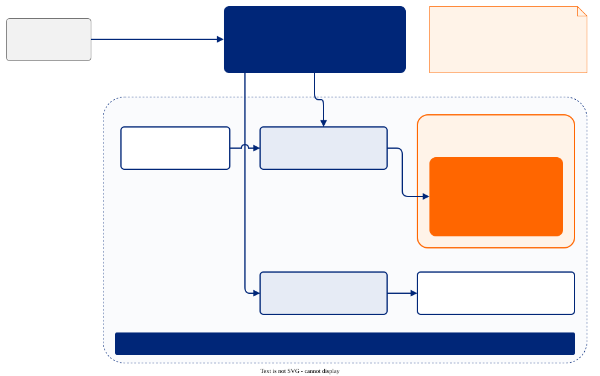

# Módulo 5: Redes (VMs y contenedores en la misma red)

**Tiempo:** 15 minutos
**Objetivo:** Ve que una VM vive en la red de Pods, se alcanza con un Service normal y habla con contenedores por nombre DNS.

## El panorama



Ten este dibujo a la mano: cada sección de abajo comprueba una de sus flechas.

## Una VM en la red de Pods

```bash
kubectl get vmi -n demo-vms vm-web -o jsonpath='{.status.interfaces[0].ipAddress}{"\n"}'
kubectl get pod -n demo-vms -l vm.kubevirt.io/name=vm-web -o wide
```

En kubevirt-manager: **Virtual Machines**, haz clic en **vm-web** y luego en la pestaña **Networking**. Muestra la NIC `default` en `podNetwork`, de tipo `masquerade`, con la misma IP.


La dirección de la VM es la dirección del Pod. La VM usa el binding `masquerade`: desde fuera se ve como cualquier Pod, así que la red del cluster, el DNS y las NetworkPolicy le aplican sin cambios.

## Un Service frente a una VM

`vm-web` es accesible desde tu navegador a través de dos objetos estándar de Kubernetes:

```bash
kubectl get svc,ingress -n demo-vms vm-web
kubectl get svc -n demo-vms vm-web -o jsonpath='{.spec.selector}{"\n"}'
```

El Service selecciona los Pods con la label `vm.kubevirt.io/name: vm-web`. Cada Pod `virt-launcher` de esa VM lleva la label, así que el Service sigue funcionando cuando la VM se reinicia o se mueve.

## Un contenedor habla con una VM

Inicia un contenedor desechable y llama a la VM por el nombre de su Service, como a cualquier microservicio:

```bash
kubectl run curl -n demo-vms --rm -it --restart=Never --image=quay.io/curl/curl:latest -- curl -s -o /dev/null -w '%{http_code}\n' http://vm-web.demo-vms.svc/
```

`200`: nginx dentro de la VM le respondió a un contenedor.

La página de inicio en tu navegador mezcla ambos mundos detrás de una sola URL: `/` va a la VM (Service `vm-web`) y `/api` va a `node-reporter`, un contenedor que lee el estado de la VM desde la API de Kubernetes:

```bash
kubectl get ingress -n demo-vms vm-web -o jsonpath='{range .spec.rules[0].http.paths[*]}{.path} -> {.backend.service.name}{"\n"}{end}'
kubectl run curl -n demo-vms --rm -it --restart=Never --image=quay.io/curl/curl:latest -- curl -s 'http://node-reporter.demo-vms.svc:8080/api/node?vm=vm-web'
```

## Expón cualquier puerto de una VM

Crea un Service para SSH en tu propia VM con un solo comando:

```bash
virtctl expose vm vm-live -n demo-vms --name vm-live-ssh --port 22 --type ClusterIP
kubectl get svc,endpoints -n demo-vms vm-live-ssh
```

Ahora cualquier Pod del cluster alcanza `vm-live-ssh.demo-vms.svc:22`.

## Más de una red

Algunas VMs también necesitan estar en una VLAN existente o en la red del data center. KubeVirt soporta interfaces secundarias con Multus: un `NetworkAttachmentDefinition` más un bridge de Linux configurado en los nodos (por ejemplo, con el operador NMState). Así la VM tiene una NIC en la red de Pods y otra directamente en la red física. Consulta `ansible/manifests/06-vm-secondary-net.yaml` para ver un ejemplo; no está habilitado en los clusters del workshop.

## Checkpoint

Una VM obtiene una IP de Pod, vive detrás de Services e Ingress y habla con contenedores por nombre DNS. Sigue: operar todo esto día tras día.
